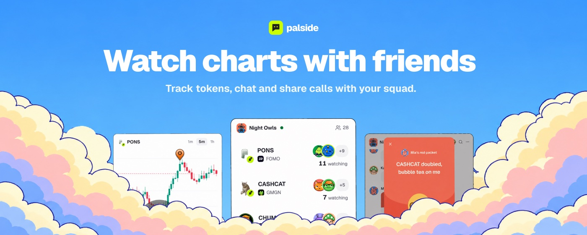
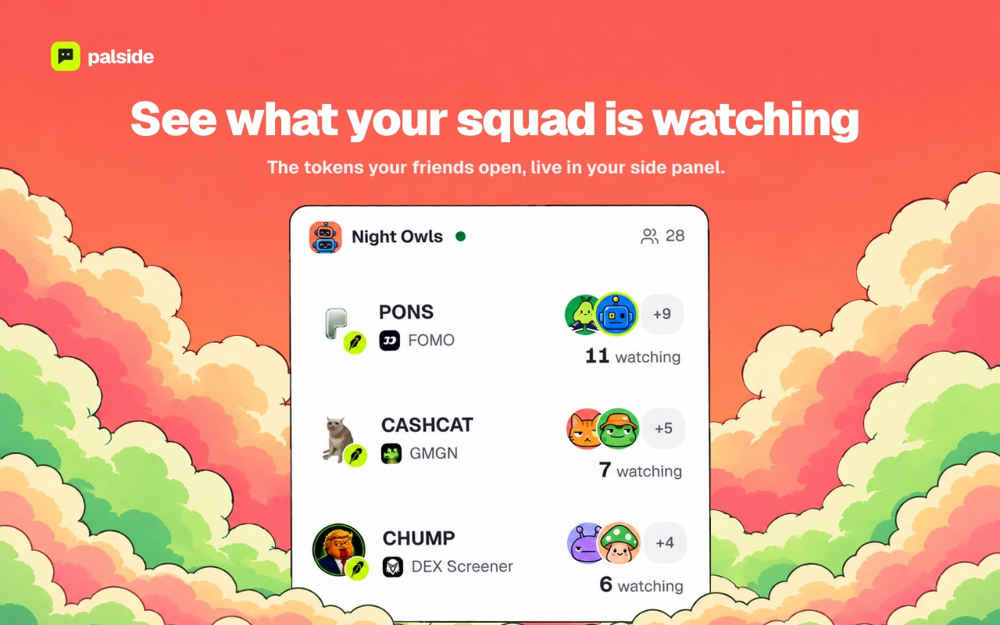
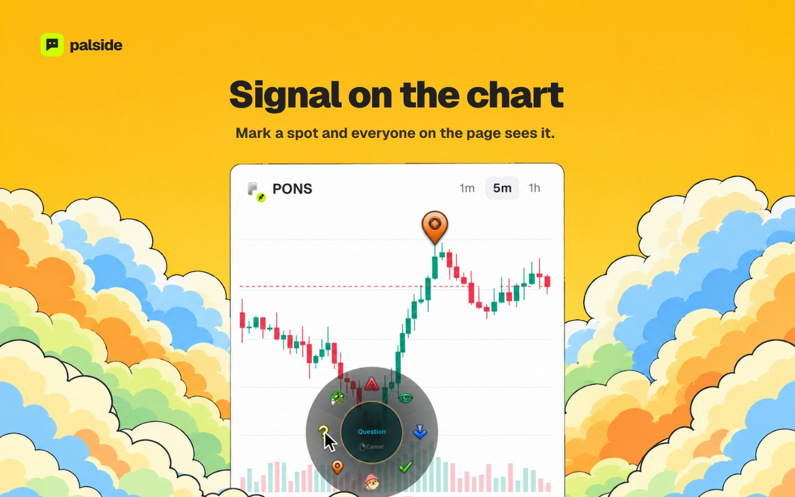
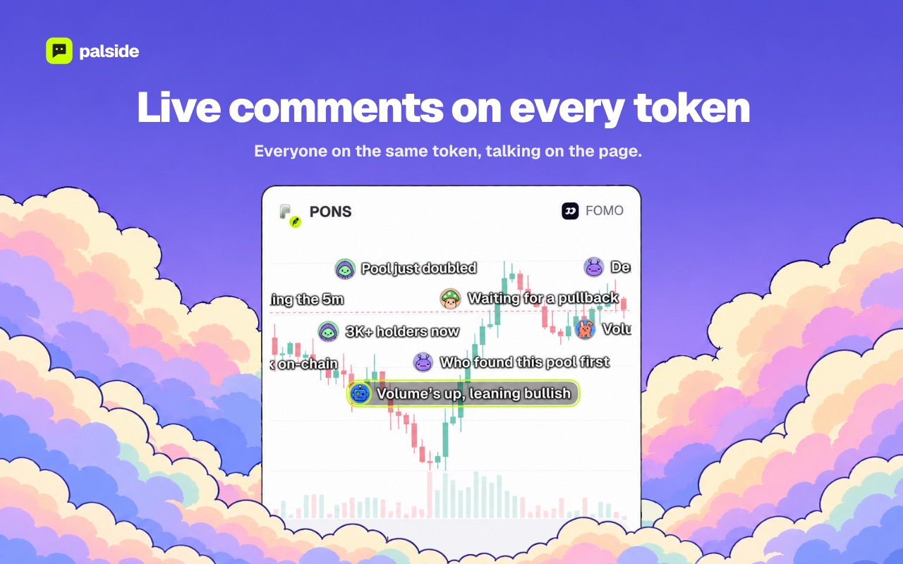
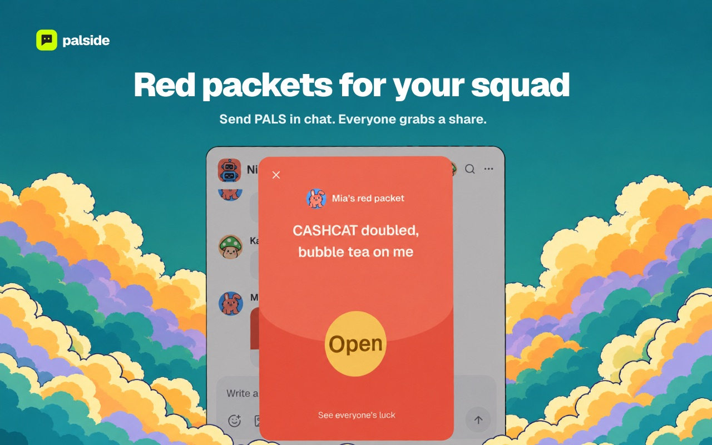
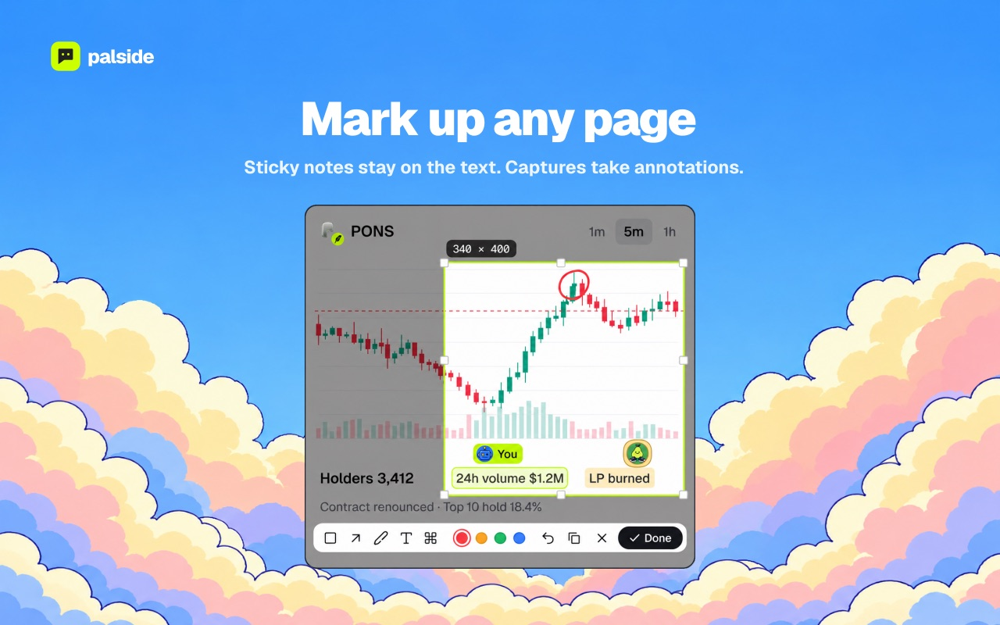

<p align="center">
  
</p>

<p align="center">
  <b>A Chrome side panel for watching charts with friends</b><br>
  Squad watching · Chart signals · Live token comments · Encrypted squad chat · PALS red packets
</p>

<p align="center">
  <a href="https://palside.xyz">Website</a> ·
  <a href="https://palside.xyz/docs">Guides</a> ·
  <a href="https://palside.xyz/security">Security</a> ·
  <a href="https://palside.xyz/privacy">Privacy</a> ·
  <a href="README.zh-CN.md">简体中文</a>
</p>

<p align="center">
  <a href="https://github.com/palsidexyz/palside-extension/actions/workflows/ci.yml"></a>
  <a href="LICENSE"></a>
  
</p>

## What it does

<table>
  <tr>
    <td colspan="2"><br><b>See what your squad is watching</b> — the tokens your friends open, live in your side panel.</td>
  </tr>
  <tr>
    <td width="50%"><br><b>Signal on the chart</b><br>Mark a spot and everyone on the page sees it.</td>
    <td width="50%"><br><b>Live comments on every token</b><br>Everyone on the same token, talking on the page.</td>
  </tr>
  <tr>
    <td width="50%"><br><b>Red packets for your squad</b><br>Send PALS in chat. Everyone grabs a share.</td>
    <td width="50%"><br><b>Mark up any page</b><br>Sticky notes stay on the text. Captures take annotations.</td>
  </tr>
</table>

## Privacy and security

- **Keys stay in the extension** — recovery phrases, keys and signatures never leave it; `apps/extension/src/runtime/wallet/` checks every requested signature against the constrained payment rules before signing.
- **End-to-end encrypted squad chat** — the Matrix SDK encrypts in a single offscreen document, and the service relays ciphertext. Public token comments are separate from private squad chat.
- **Only the pages you allow** — the extension reads a page only on sites you add, and only for the features you turn on. The manifest's permission, CSP and resource allowlists are checked by `scripts/lib/extension-artifact.mjs`.
- **Verifiable store releases** — every version can be rebuilt from its tag and compared file by file with SHA-256.

## Build from source

This repository contains the Chrome extension, the PALS red packet contracts, and the shared packages they are built from. The business service, Matrix gateway, website and operator tools are not in this repository; the extension reaches them only through the public API at `https://api.palside.xyz`.

Use the Node.js version in [`.node-version`](.node-version) and the npm version pinned in [`package.json`](package.json):

```sh
npm ci
npm run build:extension
```

Open `chrome://extensions` → enable **Developer mode** → **Load unpacked** → select `apps/extension/.output/chrome-mv3/`. After rebuilding, reload the extension before opening the panel again.

<details>
<summary><b>Work on the interface without a service</b></summary>

A local build points at local service addresses, so signing in needs a Palside service you run yourself. To work on the interface without one, open the integration review pages, which render every panel from fixtures:

```sh
node scripts/serve-integration.mjs 5173
```

</details>

<details>
<summary><b>Verify a store release</b></summary>

Each Chrome Web Store version has a matching tag here, and the tag's GitHub release carries the zip, `SHA256SUMS.txt` and a build provenance attestation. To rebuild a version from [Releases](https://github.com/palsidexyz/palside-extension/releases) yourself:

```sh
git checkout v<version>
npm ci
SOURCE_DATE_EPOCH=$(git log -1 --format=%ct) npm run package:release
```

The release script builds twice, requires identical output, and writes the zip and `SHA256SUMS.txt` to `apps/extension/.output/release/`. To check an installed copy against a release, run `npm run verify:installed -- <installed extension folder> SHA256SUMS.txt manifest.json` with the files from that release.

</details>

<details>
<summary><b>Contracts</b></summary>

[`contracts/`](contracts/) holds `PalsideRedPacket` and the test token `MockPALS`. Deployed addresses are published on [palside.xyz/security](https://palside.xyz/security). Install [Foundry](https://getfoundry.sh), then:

```sh
npm run chain:prepare
forge test --root contracts
node scripts/chain/generate.mjs --check
```

`chain:prepare` downloads the pinned OpenZeppelin and forge-std archives listed in [`contracts/dependencies.json`](contracts/dependencies.json) and checks their hashes. `generate.mjs --check` confirms the ABI in `packages/shared` matches the contracts.

</details>

<details>
<summary><b>Full checks</b></summary>

```sh
npm run check
```

This runs lint, type checks, tests, the extension build, generated-asset checks, the integration review pages in headless Chrome, and the extension artifact check. Set `CHROME_PATH` if Chrome is not found.

</details>

## Contributing

See [CONTRIBUTING.md](CONTRIBUTING.md), the [Code of Conduct](CODE_OF_CONDUCT.md), and [SECURITY.md](SECURITY.md) for private vulnerability reports.

[Website](https://palside.xyz) · [Issues](https://github.com/palsidexyz/palside-extension/issues) · [X](https://x.com/palside_xyz) · [Contact](mailto:palside@pm.me)

## License

The code is licensed under [MIT](LICENSE). The Palside name and logo are not covered by that license; see [TRADEMARKS.md](TRADEMARKS.md). Third-party dependencies, fonts, sounds and logos keep their own terms: the build writes `THIRD-PARTY.txt` to the extension's `licenses/` folder, and source records sit beside each asset folder and in [`licenses/`](licenses/).
