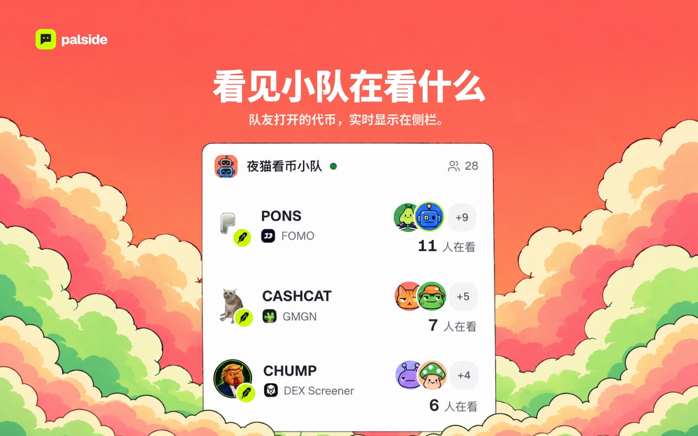
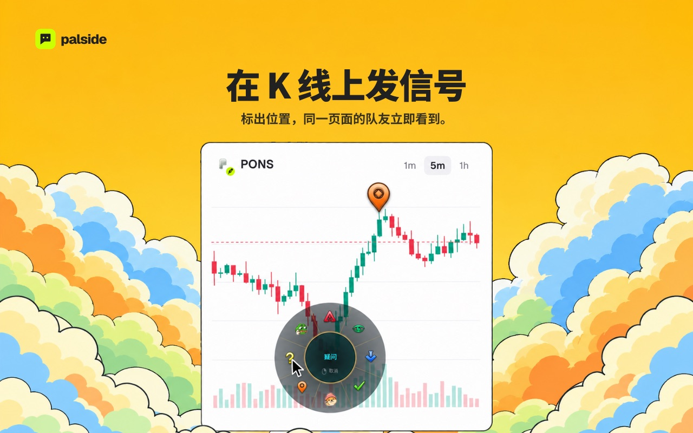
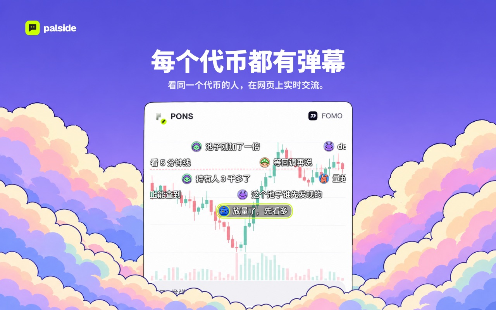
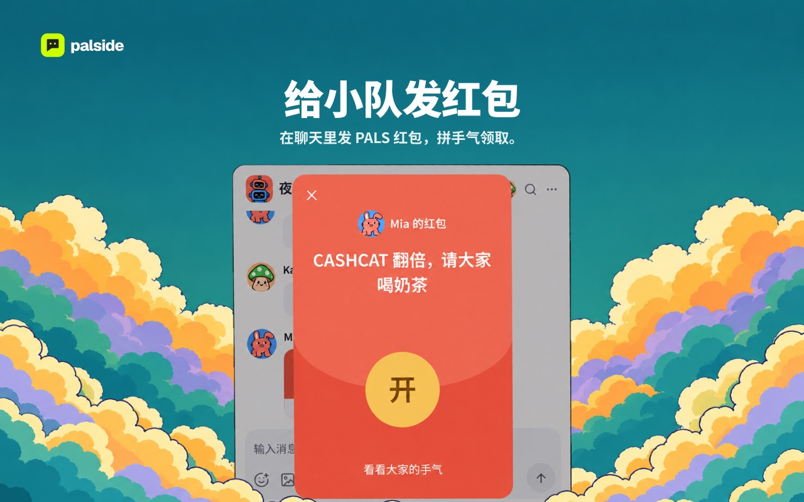

<p align="center">
  
</p>

<p align="center">
  <b>和朋友一起看币的 Chrome 侧栏扩展</b><br>
  同步在看的代币 · K 线信号 · 代币弹幕 · 加密小队聊天 · PALS 红包
</p>

<p align="center">
  <a href="https://palside.xyz">官网</a> ·
  <a href="https://palside.xyz/docs">使用指南</a> ·
  <a href="https://palside.xyz/security">安全</a> ·
  <a href="https://palside.xyz/privacy">隐私</a> ·
  <a href="README.md">English</a>
</p>

<p align="center">
  <a href="https://github.com/palsidexyz/palside-extension/actions/workflows/ci.yml"></a>
  <a href="LICENSE"></a>
  
</p>

## 能做什么

<table>
  <tr>
    <td colspan="2"><br><b>看见小队在看什么</b> — 队友打开的代币，实时显示在侧栏。</td>
  </tr>
  <tr>
    <td width="50%"><br><b>在 K 线上发信号</b><br>标出位置，同一页面的队友立即看到。</td>
    <td width="50%"><br><b>每个代币都有弹幕</b><br>看同一个代币的人，在网页上实时交流。</td>
  </tr>
  <tr>
    <td width="50%"><br><b>给小队发红包</b><br>在聊天里发 PALS 红包，拼手气领取。</td>
    <td width="50%"><br><b>在网页上标记重点</b><br>便利贴留在原文上，截图可以直接标注。</td>
  </tr>
</table>

## 隐私与安全

- **密钥不出扩展** — 助记词、私钥和签名只在本地；`apps/extension/src/runtime/wallet/` 先按付款规则核对每个签名请求，再签名。
- **小队聊天端到端加密** — Matrix SDK 在唯一的 offscreen 文档里加密，服务端只转发密文。公开弹幕与私密小队聊天分开。
- **只读你允许的网页** — 只在你添加的网站上、为你打开的功能读取网页；manifest 的权限、CSP 和资源白名单由 `scripts/lib/extension-artifact.mjs` 检查。
- **商店版本可核对** — 每个版本都能从同名标签重新构建，逐文件比对 SHA-256。

## 从源码构建

本仓库包含 Chrome 扩展、PALS 红包合约和它们所用的共享包。业务服务、Matrix 网关、官网和运营工具不在本仓库；扩展只通过公开接口 `https://api.palside.xyz` 访问它们。

使用 [`.node-version`](.node-version) 中的 Node.js 和 [`package.json`](package.json) 固定的 npm：

```sh
npm ci
npm run build:extension
```

打开 `chrome://extensions` → 开启**开发者模式** → **加载已解压的扩展程序** → 选择 `apps/extension/.output/chrome-mv3/`。重新构建后，先重新加载扩展，再打开侧栏。

<details>
<summary><b>不连服务，只改界面</b></summary>

本地构建连接本机服务地址，登录需要你自己运行的 Palside 服务。只改界面时，打开集成审查页，它们用测试数据渲染每个面板：

```sh
node scripts/serve-integration.mjs 5173
```

</details>

<details>
<summary><b>核对商店版本</b></summary>

每个商店版本在这里都有同名标签，对应的 GitHub Release 附带 zip、`SHA256SUMS.txt` 和构建来源证明。自己重新构建 [Releases](https://github.com/palsidexyz/palside-extension/releases) 中的某个版本：

```sh
git checkout v<version>
npm ci
SOURCE_DATE_EPOCH=$(git log -1 --format=%ct) npm run package:release
```

发版脚本构建两次并要求结果一致，然后把 zip 和 `SHA256SUMS.txt` 写到 `apps/extension/.output/release/`。要核对已安装的扩展，用该版本 Release 里的文件运行 `npm run verify:installed -- <已安装扩展的目录> SHA256SUMS.txt manifest.json`。

</details>

<details>
<summary><b>合约</b></summary>

[`contracts/`](contracts/) 包含 `PalsideRedPacket` 和测试代币 `MockPALS`，部署地址见 [palside.xyz/security](https://palside.xyz/security)。先安装 [Foundry](https://getfoundry.sh)：

```sh
npm run chain:prepare
forge test --root contracts
node scripts/chain/generate.mjs --check
```

`chain:prepare` 下载 [`contracts/dependencies.json`](contracts/dependencies.json) 中固定版本的 OpenZeppelin 和 forge-std 并校验哈希。`generate.mjs --check` 确认 `packages/shared` 里的 ABI 与合约一致。

</details>

<details>
<summary><b>完整检查</b></summary>

```sh
npm run check
```

依次运行 lint、类型检查、测试、扩展构建、生成素材检查、无头 Chrome 中的集成审查页，以及扩展产物检查。找不到 Chrome 时设置 `CHROME_PATH`。

</details>

## 参与贡献

见 [CONTRIBUTING.md](CONTRIBUTING.md) 和[行为准则](CODE_OF_CONDUCT.md)；漏洞请按 [SECURITY.md](SECURITY.md) 私下报告。

[官网](https://palside.xyz) · [Issues](https://github.com/palsidexyz/palside-extension/issues) · [X](https://x.com/palside_xyz) · [联系](mailto:palside@pm.me)

## 许可证

代码采用 [MIT](LICENSE) 许可证。Palside 名称和 Logo 不在该许可证范围内，见 [TRADEMARKS.md](TRADEMARKS.md)。第三方依赖、字体、音效和 Logo 保留各自的条款：构建会在扩展的 `licenses/` 目录生成 `THIRD-PARTY.txt`，素材来源记录放在各素材目录和 [`licenses/`](licenses/) 中。
